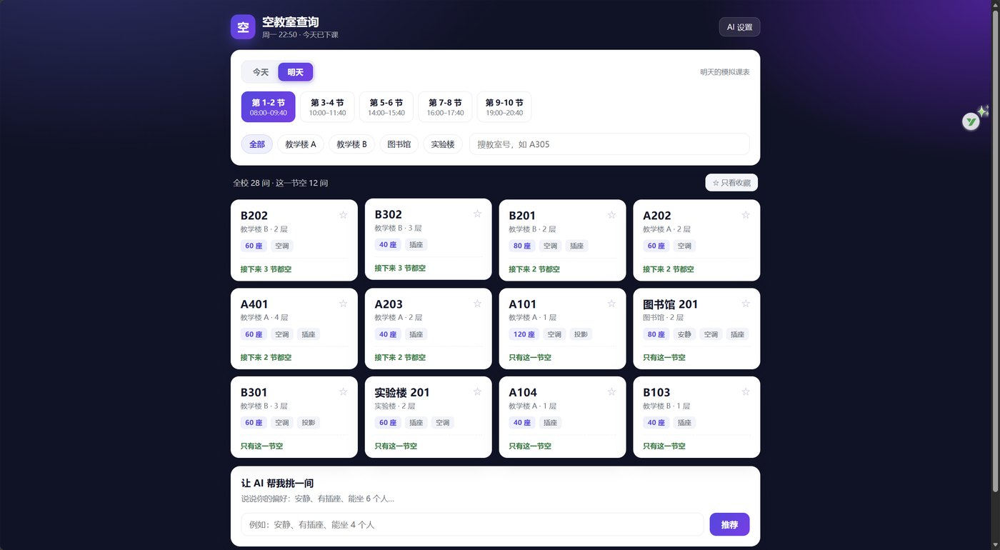

# 空教室查询 · Axiom 黑客松 2026

北信科的同学想自习，却不知道哪间教室现在空着，只能一层层走。
这个网页做一件事：**选出时间和楼栋，直接告诉你哪几间空、能连空几节。**



> 演示地址：<https://snazzy-sprite-379ec1.netlify.app>
> （线上跑的是单文件版；改了代码运行 `python build_single.py` 再 `python tools/build_deploy.py` 重新打包）

## 现在能做什么

| 功能 | 说明 | 用到的技术 |
| --- | --- | --- |
| 今天 / 明天切换 | 打开时自动判断：上课中→当前节次，课间→下一节，已下课→明天第一节 | `Date`、时间段计算 |
| 五个节次选择 | 第 1-2 节到第 9-10 节，显示具体起止时间 | 数组渲染、事件委托 |
| 楼栋筛选 + 搜索 | 全部 / 教学楼 A / B / 图书馆 / 实验楼；也可搜「A305」 | `filter` |
| 教室卡片 | 教室号、楼层、座位、设施标签、「接下来 N 节都空」 | DOM 渲染 |
| 收藏常去教室 | 点 ☆ 收藏，存本机，下次自动排最前 | `localStorage` |
| 教室详情时间轴 | 点卡片看这间今天/明天每一节是空还是有课 | `Core.daySchedule` |
| 状态写进地址栏 | 刷新不跳回默认；把 `#day=1&period=3&building=lib` 发给同学，打开就是同一个视图 | `URLSearchParams`、`history` |
| AI 推荐 | 输入「安静、有插座、能坐 4 人」，从当前空教室里挑一间并说明理由 | `fetch` + 错误降级 |
| 断网可用 | 没有 API Key 时自动走本地规则推荐，页面功能不受影响 | 降级设计 |

## 30 秒跑起来

**方法 1：双击** `index.html`（能看，但联网调 AI 会被浏览器的 CORS 策略拦）

**方法 2：本地服务器（推荐）**

```bash
python -m http.server 8000
```

打开 <http://localhost:8000>。

**方法 3：双击** `开始演示.bat`（Windows 上一键干完方法 2 的事，还会打印手机能打开的局域网地址）

> 注意：`index.html` 和 `assets/` 必须待在同一个文件夹里。单独把 `index.html` 拷走，样式和功能都会失效——它用相对路径引用另外几个文件。

## 三个版本

| 文件 | 用途 |
| --- | --- |
| `index.html` + `assets/` | 开发用，改代码改这里（**部署上线用这个**） |
| `空教室查询-单文件版.html` | 全部代码在一个文件里，双击即开，可微信发送 |
| `lessons/01-hello.html` | 20 行最小网页，理解 HTML/CSS/JS 分工 |

单文件版是**自动生成**的，别手改：

```bash
python build_single.py
```

## 代码结构

```
assets/
├── core.js    数据和规则：教室表、排课模拟、筛选、推荐。不碰页面，可以单独测试
├── app.js     界面：把 core 算出来的结果画成卡片，响应点击
└── style.css  样式：改 :root 里的几个变量就能换配色

tests/
└── test_core.cjs   26 条逻辑断言，改完数据先跑它

参赛包/
├── Axiom新手参赛执行手册.docx     赛前日程、48h 作战表、检查清单
├── 答辩与演示包-空教室查询.docx   三分钟逐字稿、录屏分镜、12 个追问答案
├── README-提交模板.md            比赛要交的 README 骨架
└── 部署包-空教室查询.zip          拖到 EdgeOne / Netlify 就能上线（根目录已是 index.html）

build_single.py   把三个源文件打包成单文件版
开始演示.bat      双击起本地服务，顺手打印手机能用的局域网地址
部署指南-不用GitHub.md  没有 GitHub 账号时，怎么拿到一个能发给别人的链接
```

为什么拆两层？因为页面会一直改，规则不会。规则单独放，测试起来也方便（见下）。

## 数据从哪来（重要，答辩会被问）

**现在是模拟数据。** 28 间教室、5 个节次的占用情况由 `core.js` 里的 `isOccupied()` 用「确定性伪随机」算出来：

```js
hash(教室号 | 日期 | 节次) % 100 < 该节次的占用权重
```

同一间教室、同一天、同一节次永远算出同一个结果，所以刷新页面不会乱跳，看起来像真数据。

**换成真实数据要改两个地方：**

1. `ROOMS` 数组 → 换成教务系统里的真实教室（编号、楼层、座位、设施）
2. `isOccupied()` → 换成请求真实排课接口（需要教务权限，学生拿不到）

答辩时主动说这一句：「目前是模拟排课，接口通了改一个函数就能接真实数据」——比被评委问出来强。

## 跑测试

数据改了以后，先跑逻辑测试，再打开页面：

```bash
node tests/test_core.cjs
```

会检查：教室编号无重复、每节空置率在合理区间、筛选生效、收藏置顶、时间推断正确、推荐规则命中。全部通过再去点页面。

## 部署上线 · 不用 GitHub

比赛要的是「能打开的链接」，GitHub 只是其中一种做法。三条路，任选一条：

**A. 腾讯云 EdgeOne（推荐，国内打开快）**

1. <https://pages.edgeone.ai/drop> → 微信扫码登录
2. 控制台 **创建项目** → **直接上传**（不是「导入 Git 仓库」）
3. 项目名用小写字母/数字/连字符，如 `empty-classroom`
4. 把 `参赛包\部署包-空教室查询.zip` 拖进去 → **开始部署**
5. 拿到 `https://xxx.edgeone.app`，填到本文件顶部那一行

**B. Netlify Drop（备选）**：<https://app.netlify.com/drop> 拖同一个 zip，邮箱注册即可。

**C. 不联网**：双击 `开始演示.bat` 起本地服务，手机上输入它打印的局域网地址；或直接双击单文件版。

> 📄 每一步的截图级说明、404 怎么修、防火墙怎么放行，都在 [部署指南-不用GitHub.md](部署指南-不用GitHub.md)。

⚠️ 两个最容易踩的坑：

- zip 里**不能多套一层文件夹**，`index.html` 必须在最外层，否则打开是 404
- `index.html` 必须和 `assets/` 一起传，单独拷走 html 会丢样式

**不要把 API Key 写进代码。** 这个项目让用户在页面上自己填 Key，存在浏览器本地，代码里是干净的。

## 已知限制

- 排课数据是模拟的，没有接教务系统
- 只区分「今天 / 明天」，没有日历选择
- 收藏只存在本机，换设备不同步
- 没有做教室实时人数（需要传感器或门禁数据）

## 48 小时改造路线

| 阶段 | 做什么 |
| --- | --- |
| 周六上午 | 换文案、配色、校名，先部署一次拿到链接 |
| 周六下午 | 把模拟数据换成你专业的真实课表（问学长要一份） |
| 周六晚上 | 提交第一版占位（README + 链接） |
| 周日上午 | 加一个真功能：「我在这间」打卡，或按距离排序 |
| 周日下午 | 录屏 30 秒、写答辩稿、补 README |

---

## 开发日志（真实记录，答辩可直接引用）

| 日期 | 做了什么 | 踩到的坑 |
| --- | --- | --- |
| 10-27 | 定题、写数据模型：28 间教室 × 5 个节次 | — |
| 10-28 | 第一版界面：筛选、卡片、收藏 | 设置弹层的 `hidden` 被 CSS 的 `display:grid` 覆盖，页面一打开就盖一层黑罩 |
| 10-29 | 加教室详情时间轴；把规则拆出 `core.js` 并写测试 | — |
| 11-02 | 部署上线（Netlify） | ① EdgeOne 免费域名只有 3 小时，去掉 token 就是 401 ② 拖 zip 时 `assets/` 目录丢失，样式全 404 ③ 中文文件名被上传校验拒绝 |

## 决策记录（评委问「为什么这么做」时用）

**1. 按「能连空几节」排序，不按座位数**
来自习的人最在意能坐多久，不是屋子多大。座位数只在连空节数相同时作为次级排序。

**2. 排课用确定性伪随机，而不是每次随机**
随机假数据一刷新就变，演示时当场穿帮。用「教室号 + 日期 + 节次」算固定哈希，
同一间教室每天状态不变，看起来像真数据，也方便写测试。

**3. 规则拆到 `core.js`，界面留在 `app.js`**
页面会一直改，规则不会。拆开后规则能脱离浏览器跑测试（30 条断言），
改数据不怕改坏界面。

**4. 没有 API Key 时降级到本地规则，而不是报错**
比赛现场网络不可靠。断网时功能变弱但不会挂，「断网也能演示」在答辩现场是加分项。

**5. 部署用单文件版，开发用多文件版**
多文件版适合协作，但拖 zip 上传时子目录容易丢；单文件版没有目录结构，怎么传都不会错。
两种版本都由脚本生成，不会不同步。
